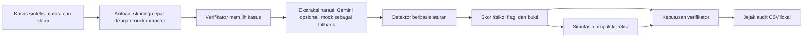

# ClaimWise

**Verifikasi klaim INA-CBGs berbasis narasi klinis**

ClaimWise adalah prototipe untuk membantu verifikator meninjau kesesuaian antara narasi klinis berbahasa Indonesia dan kode diagnosis/prosedur pada klaim. Fokus MVP ini adalah indikasi **upcoding** dan **unbundling** sebelum pembayaran. Sistem menyajikan temuan sebagai bahan tinjauan; keputusan akhir tetap pada verifikator.

## Tujuan

Informasi klinis yang relevan dapat berada di narasi bebas seperti resume medis atau catatan CPPT, sementara pemeriksaan klaim sering dimulai dari field yang terstruktur. ClaimWise mendemonstrasikan bagaimana ekstraksi fakta dari narasi dapat membantu menyoroti klaim yang perlu ditinjau lebih lanjut.

Proyek ini merupakan prototipe evaluasi, bukan sistem adjudikasi atau deteksi fraud produksi.

## Alur MVP



Antrian menggunakan mock extractor untuk memproses seluruh kasus dengan cepat. Saat satu kasus dibuka, extractor review memakai Gemini jika `GEMINI_API_KEY` tersedia; jika tidak, aplikasi memakai mock extractor berbasis kata kunci. Detector membandingkan hasil ekstraksi dengan klaim menggunakan aturan sederhana. Dashboard menampilkan narasi, klaim, bukti kutipan, skor risiko, dan simulasi koreksi. Verifikator memilih keputusan dan mencatatnya ke CSV lokal.

## Fitur yang Tersedia

- Generator kasus sintetis dengan seed dan label ground truth untuk evaluasi.
- Mock extractor untuk demo offline serta Gemini extractor opsional.
- Deteksi berbasis aturan untuk upcoding, diagnosis yang tidak didukung narasi, dan sebagian pola unbundling.
- Dashboard untuk antrian, review kasus, dan jejak keputusan verifikator.
- Simulasi perubahan severity/prosedur dan estimasi tarif ilustratif.
- Evaluasi precision, recall, F1, dan recall per tipe fraud pada data sintetis.

## Batasan dan Penggunaan

- Dataset saat ini sintetis. Jangan memasukkan data pasien atau klaim nyata.
- Kode, aturan bundling, dan detektor disederhanakan untuk prototipe; belum menjadi knowledge base resmi INA-CBGs.
- Tarif pada simulasi hanya ilustrasi, bukan tarif resmi atau dasar pembayaran.
- Skor risiko adalah alat prioritisasi, bukan probabilitas fraud atau keputusan otomatis.
- MVP belum terintegrasi dengan BPJS, SIMRS, SATUSEHAT, VClaim, atau sistem klaim lainnya.
- Jejak keputusan disimpan ke CSV lokal; belum cocok untuk audit produksi atau penyimpanan persisten di hosting.

## Menjalankan Secara Lokal

Gunakan Python 3.10 atau lebih baru dari direktori root proyek.

```bash
python -m pip install -r requirements.txt
python data/generator.py --n 200 --fraud-rate 0.3 --seed 42
python eval/evaluate.py --n 200 --seed 123 --extractor mock
streamlit run dashboard/app.py
```

Dashboard tersedia di alamat lokal yang dicetak oleh Streamlit, biasanya `http://localhost:8501`.

### Menggunakan Gemini

Gemini bersifat opsional. Atur environment variable `GEMINI_API_KEY` sebelum menjalankan aplikasi atau evaluasi dengan `--extractor gemini`. Simpan kunci API secara lokal atau melalui secret manager; jangan commit kunci ke repository. Tanpa kunci, aplikasi menggunakan mock extractor.

## Struktur Repository

```text
data/
  generator.py       Membuat kasus klinis sintetis dan klaim berlabel
  synthetic/         Dataset demo dalam format JSONL
pipeline/
  extractor.py       Ekstraksi fakta dengan mock atau Gemini
  detector.py        Aturan deteksi dan skor risiko
  tariff.py          Tarif ilustratif untuk simulasi
  whatif.py          Simulasi dampak koreksi klaim
dashboard/
  app.py             Antrean, review kasus, keputusan, dan audit
eval/
  evaluate.py        Evaluasi detektor pada data sintetis
requirements.txt     Dependency Python
```

## Evaluasi dan Tahap Berikutnya

Jalankan `python eval/evaluate.py --n 200 --seed 123 --extractor mock` untuk mereproduksi evaluasi baseline pada data sintetis. Hasil ini mengukur perilaku prototipe pada generator kasus yang tersedia, bukan performa pada data klinis nyata.

Langkah lanjutan yang direncanakan mencakup pengukuran mock dibanding Gemini, pengayaan aturan INA-CBGs dari sumber resmi, pengujian kasus adversarial, serta penyimpanan keputusan yang persisten.
